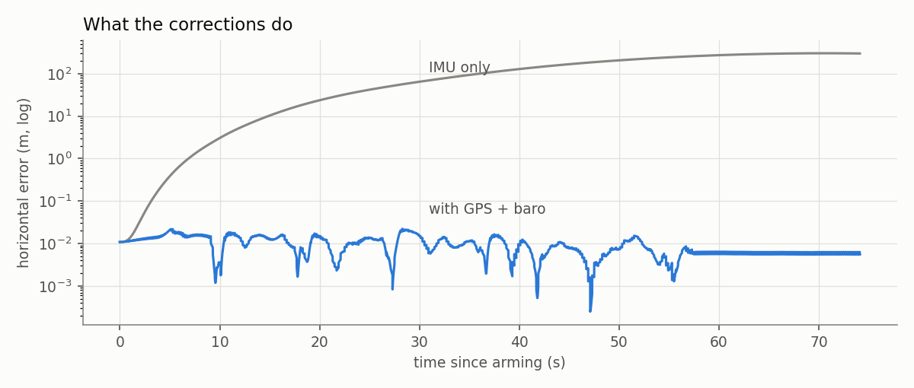
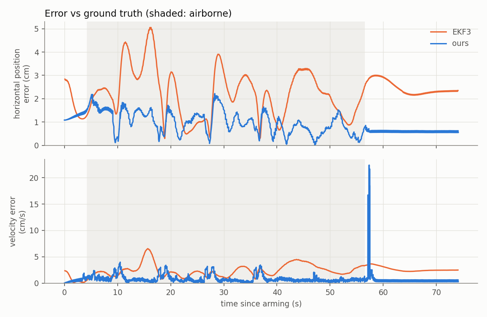
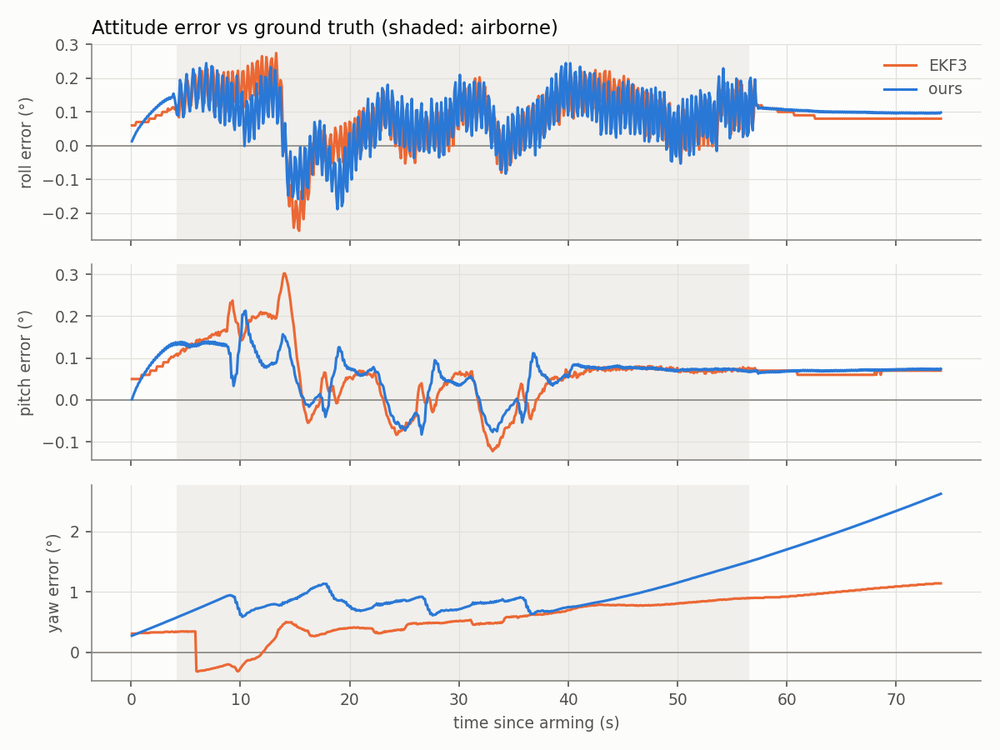
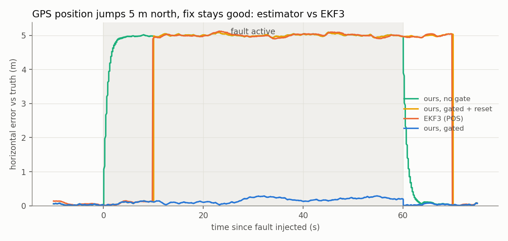
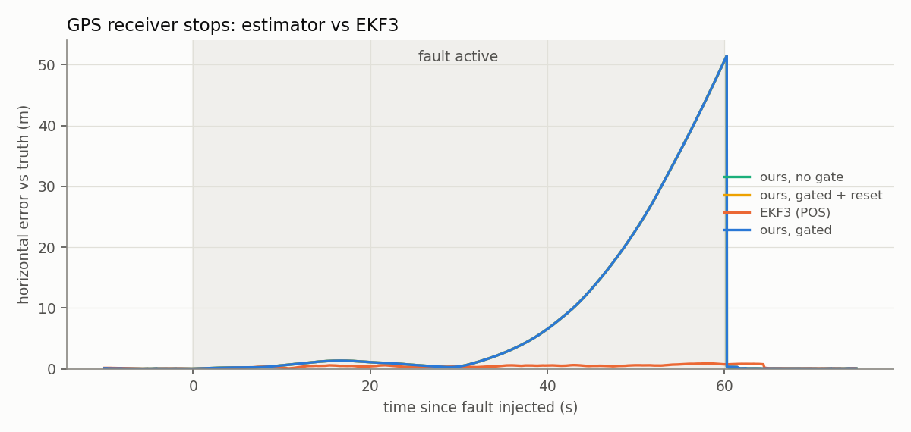

# Custom INS/GNSS estimator vs EKF3

ArduPilot's EKF3 is usually treated as a black box: you pick which sensors it
uses and trust what comes out. Here I wrote a small Kalman filter of my own,
ran it on the same flight data, and compared both against ground truth.

It runs offline on a recorded SITL log, so nothing on the vehicle depends on it.

## The flight

One scripted flight in ArduPilot SITL with Gazebo
([`shuttle_flight.py`](../ga_ws/src/ga_vehicle/ga_vehicle/shuttle_flight.py)):
take off to 5 m, fly 5 m forward, turn around, 7 m back, turn, 7 m forward,
turn, 5 m back, land. About a minute in the air.

By default ArduPilot only logs the IMU at 25 Hz, which is too coarse to
integrate. A separate launcher ([`start_estimator.sh`](../scripts/start_estimator.sh))
turns on Fast IMU logging, so the log has the IMU at 400 Hz along with GPS
(5 Hz), baro (10 Hz), EKF3's output and SITL's ground truth.

## The filter

An error-state EKF, the usual structure for IMU-based navigation. Code is in
[`ga_est/`](../ga_est/).

It keeps 15 numbers: position, velocity, attitude, and a bias for the gyro and
the accelerometer. Every IMU sample it takes the gyro and accelerometer
readings, removes the current bias estimates, and integrates them forward. On
its own that drifts fast. A tiny gyro bias tilts the attitude estimate, the
tilt leaks gravity into the horizontal acceleration, and position error grows
with time cubed.

GPS position and velocity (5 Hz) and baro altitude (10 Hz) pull it back. Each
correction also nudges the bias estimates, which is how the filter learns that
the gyro reads about 0.002 rad/s off. Once the biases are learned the IMU
prediction between GPS fixes is good enough that the error stays around a
centimetre.



A few details that mattered more than expected:

- **GPS is 100 ms old.** SITL delays GPS by 100 ms, like a real receiver.
  Comparing each fix with the current state costs about 5 cm, more than
  EKF3's whole error. The filter keeps a short history and compares each fix
  with where it thought it was 100 ms earlier.
- **The logged IMU is filtered.** ArduPilot logs the IMU after its 20 Hz
  low-pass filter, which adds about 11 ms of delay. Before allowing for that,
  roll error was 0.27°; after, 0.10°, the same as EKF3.
- **Heading at startup.** With only IMU, GPS and baro, yaw can't be known
  until the drone moves. The compass is read once at startup to set the
  initial heading and not used after that.

## Running it

```bash
bash scripts/start_estimator.sh                 # SITL + Gazebo + MAVROS
ros2 run ga_vehicle shuttle_flight              # fly the path

python3 -m ga_est.log_loader runs/estimator/logs/00000001.BIN
python3 -m ga_est.run_filter runs/estimator/logs/00000001.npz --predict-only
python3 -m ga_est.run_filter runs/estimator/logs/00000001.npz
python3 -m ga_est.compare runs/estimator/logs/00000001.npz --out docs/img
```

`log_loader` puts everything into one local NED frame, `run_filter` runs the
filter and scores it, `compare` makes the plots and table below.

For the fault cases further down, run the [fault matrix](fault_matrix.md)
batch first, then:

```bash
python3 -m ga_est.compare_faults runs/faults/gps_glitch_5m/run_1 --plot docs/img/est_glitch.png
python3 -m ga_est.compare_faults runs/faults/gps_loss/run_1 --plot docs/img/est_gps_loss.png
```

`run_filter` also takes `--gate` and `--gate-timeout S` on its own. Both are
off by default, so the clean-flight numbers below don't change.

## Results

Error against ground truth while airborne:

| | Horizontal (mean) | Horizontal (max) | Vertical (mean) | Velocity (mean) | Roll / pitch / yaw (mean) |
|---|---|---|---|---|---|
| Mine | 1.0 cm | 2.2 cm | 0.3 cm | 0.8 cm/s | 0.10° / 0.07° / 0.89° |
| EKF3 | 2.2 cm | 5.1 cm | 1.5 cm | 2.4 cm/s | 0.10° / 0.08° / 0.53° |



Position is a few centimetres for both. Mine looks tighter, but I wouldn't
read much into that. SITL's GPS has no noise in this run and I told my filter
to trust GPS to 5 cm, so it just follows it closely. EKF3 assumes a much
noisier GPS and smooths more. With realistic GPS noise I'd expect that gap to
close or flip. The spike near 57 s is touchdown.



Roll and pitch line up with EKF3 almost exactly. Yaw is where mine is weaker.
Without the compass, the only thing that corrects yaw is GPS velocity while
the drone is accelerating, so yaw drifts slowly whenever it isn't, before the
first leg and again from about 37 s. EKF3 keeps using the compass and stays
flatter.

## Under faults

The [fault matrix](fault_matrix.md) runs log the IMU at 400 Hz too, so the
same filter can be run on them. I added one thing for this: an innovation
gate. Before each GPS fix is used, the filter checks how far it is from the
prediction relative to the expected uncertainty (a chi-square test at
99.9%), and throws it out if it's too far. Position and velocity are tested
separately, like EKF3 does.

Three versions were compared against what EKF3 actually flew on: no gate, a
gate, and a gate that gives in after 10 s of rejecting, which is what EKF3
seems to do.

| Fault | No gate | Gate | Gate + 10 s reset | EKF3 |
|---|---|---|---|---|
| GPS glitch, 5 m (error during glitch) | 4.94 m | **0.15 m** | 4.18 m | 4.19 m |
| GPS loss, 60 s (error during outage, mean / max) | 9.0 / 50 m | same | same | 0.44 / 0.91 m |



With the gate, the filter rejected every one of the 300 glitched fixes and
stayed within 0.3 m of the truth for the whole minute. EKF3 gave in after
10 s. The gate with a 10 s reset lands on EKF3's numbers almost exactly. That
isn't proof, but it's a strong hint that this is how EKF3 handles it.



GPS loss isn't a fair fight. My filter has no optical flow, so it's IMU-only
for 60 s and drifts to 50 m. EKF3 on flow stays under a metre. It does show
what the flow backup is worth. When GPS came back, all three versions took it
straight away. After a minute alone the filter knows it is lost, so the GPS
doesn't look like a glitch.

Two things I got wrong first:

- **Testing GPS position and velocity together.** The glitch only moves the
  position, but rejecting the whole fix also threw away good velocity. With
  nothing correcting velocity the uncertainty grew fast, and after about 5 s
  a 5 m jump no longer looked unusual.
- **Letting the baro touch horizontal position.** Without GPS the filter's
  horizontal uncertainty grows to hundreds of metres. A tiny correlation with
  height then turns every 0.2 m baro wiggle into metres of horizontal jump.
  The baro now only corrects height-related states. On the clean flight that
  changed nothing.

## Limitations

- The clean flight is one flight with noise-free sensors. It shows the maths
  and the timing are right, but it doesn't stress the filter much.
- Noise settings were picked by hand. The GPS innovations come out far
  smaller than the filter expects, so it's cautious rather than tuned.
- No compass after startup, hence the yaw drift.
- The IMU delay is a fixed estimate. Logging raw IMU (`LOG_BITMASK` bit 19)
  would avoid it altogether.
- SITL can't add horizontal GPS noise, so the filter's GPS tuning is still
  untested against a noisy receiver.
