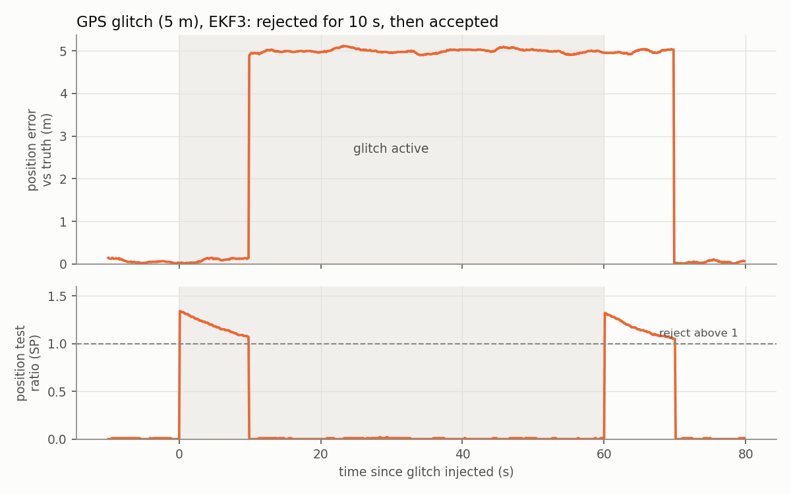
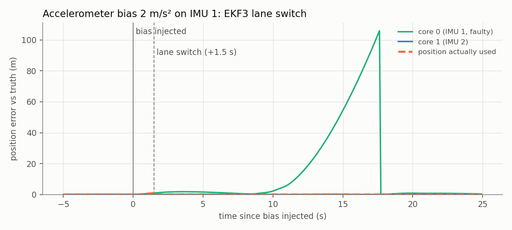

# EKF3 fault matrix

The [GPS loss experiment](p1_gps_loss_flow_fallback.md) was one fault, flown
by hand. This is the systematic version: nine fault cases, five runs each,
all scripted, and every run scored against ground truth for detection time,
what the vehicle did about it, and how far its position estimate drifted.

## Setup

Everything runs on ArduPilot SITL's built-in physics, no Gazebo and no ROS.
That makes a run start in seconds, and at 5× speed one run (about three
minutes of flight) takes around 35 s.

- **Sensors:** GPS, two IMUs, three compasses, baro, plus SITL's own
  rangefinder and optical flow ([`batch.parm`](../ga_sim/params/batch.parm)).
- **Fusion:** the same two EKF3 source sets as before, GPS first and optical
  flow as backup ([`p1_sources.parm`](../ga_sim/params/p1_sources.parm)).
- **Switching:** onboard, with a copy of ArduPilot's
  `ahrs-source-gps-optflow.lua`
  ([ours](../ga_sim/scripts/ahrs-source-gps-optflow-auto.lua)). Two changes
  were just to run it without an RC transmitter. The third fixes a real gap:
  the stock script only looks at GPS speed accuracy, and when a GPS stops
  completely ArduPilot keeps reporting the last good accuracy value. So the
  stock script never switches on an outright GPS loss. Ours also checks for a
  3D fix.
- **Noise:** baro, GPS velocity, GPS altitude and some gyro noise
  ([`batch_noise.parm`](../ga_sim/params/batch_noise.parm)). This SITL build
  can't do random accelerometer noise or horizontal GPS position noise, and it
  uses the same random sequence every run. To still get spread between runs,
  each fault goes in at a random point of the flight, 30–40 s after takeoff.

Each run takes off to 5 m, flies a back-and-forth pattern, injects the fault,
clears it 60 s later and lands. The fault is just a `SIM_` parameter, and the
runner puts the original value back afterwards.

## Running it

```bash
python3 -m ga_faults.run --list                  # the fault cases
python3 -m ga_faults.run --fault all --runs 5    # ~30 min for everything
python3 -m ga_faults.matrix                      # the table below
python3 -m ga_faults.plots                       # the two plots below
```

Each run ends up in `runs/faults/<fault>/run_<k>/` with its dataflash log and
a `run.json` of the exact inject and clear times. Per-run results are in
[`data/fault_matrix.csv`](data/fault_matrix.csv).

## The matrix

"Detection" is the first sign EKF3 reacted: one of its test ratios going
above 1, or a status message. "Error" is the position ArduPilot was actually
using against ground truth, while the fault was active.

| Fault | Detected | Detection time | Detected by | What it did | Error (mean / max) | Recovered |
|---|---|---|---|---|---|---|
| None (baseline) | — | — | — | — | 0.05 / 0.17 m | 5/5 |
| GPS loss | 5/5 | 4.5 s | Lua script | switched to optical flow | 0.32 / 0.92 m | 5/5 |
| GPS glitch, 5 m | 5/5 | 0.2 s | position test ratio | rejected GPS for 10 s, then accepted it | 4.18 / 5.16 m | 5/5 |
| Accel bias 0.5 m/s² | 0/5 | — | — | nothing | 0.23 / 0.78 m | 5/5 |
| Gyro bias 0.02 rad/s | 0/5 | — | — | nothing | 0.28 / 0.89 m | 5/5 |
| Accel bias 2.0 m/s² | 5/5 | 1.4 s | EKF3 message | lane switch to IMU 2 | 0.06 / 0.88 m | 5/5 |
| Gyro bias 0.1 rad/s | 5/5 | 2.5 s | EKF3 message | lane switch to IMU 2 | 0.06 / 1.00 m | 3/5 |
| Compass offset | 5/5 | 0.2 s | compass test ratio | briefly switched compass | 0.05 / 0.18 m | 5/5 |
| Compass failure | 5/5 | 10.0 s | EKF3 message | switched to compass 2 | 0.05 / 0.19 m | 5/5 |

Runs were very repeatable. The spread in detection time was under 0.3 s for
every fault.

## What stood out

**A GPS glitch is caught fast but not for long.** EKF3 flagged the 5 m jump
within 0.2 s and refused it, but only for 10 s. Then it reset its position
onto the glitched GPS and stayed 5 m off for the rest of the glitch. When the
glitch was removed, the same thing happened in reverse.



That's a deliberate trade-off. A filter that never gives in would also lock
out a GPS that really had moved. The [custom estimator](estimator.md#under-faults)
shows the other side: with a gate and no timeout it held the glitch off for
the full minute.

**Small IMU biases go unnoticed.** Half a m/s² on one accelerometer, or about
1°/s on one gyro, never triggered anything. EKF3 absorbed them, and the cost
was a position error four to six times the baseline.

**Large IMU biases trigger lane switching, and it works.** EKF3 runs one
filter per IMU. Within 1.5–2.5 s it moved to the healthy one, and the error
of the position actually in use hardly changed. The faulty lane, left on its
own, drifted to over 100 m before it was reset.



**The faulty lane can come back.** In two of the five large gyro bias runs,
EKF3 made core 0 primary again on landing, the core that had been running on
the bad IMU. Its position was 3.5–12 m off and it raised a "GPS Glitch"
error. In flight nothing was wrong, but a re-arm in that state would start
with a bad estimate.

**Compass faults didn't move the position.** A failed compass was replaced
by the second one after 10 s. An offset was flagged almost at once.

**GPS loss falls back cleanly** once the script can actually see it, with
about 0.3 m of error over the 60 s outage.

## Limitations

- Simulation, built-in physics, one flight pattern, one size of each fault
  (two for the IMU biases). The thresholds are ArduPilot defaults.
- SITL's noise is limited and repeats every run, so the run-to-run spread
  comes mostly from when the fault hits.
- "Detection" is a heuristic: first test ratio above 1 or first relevant
  message. It's consistent across faults but not an official ArduPilot metric.
