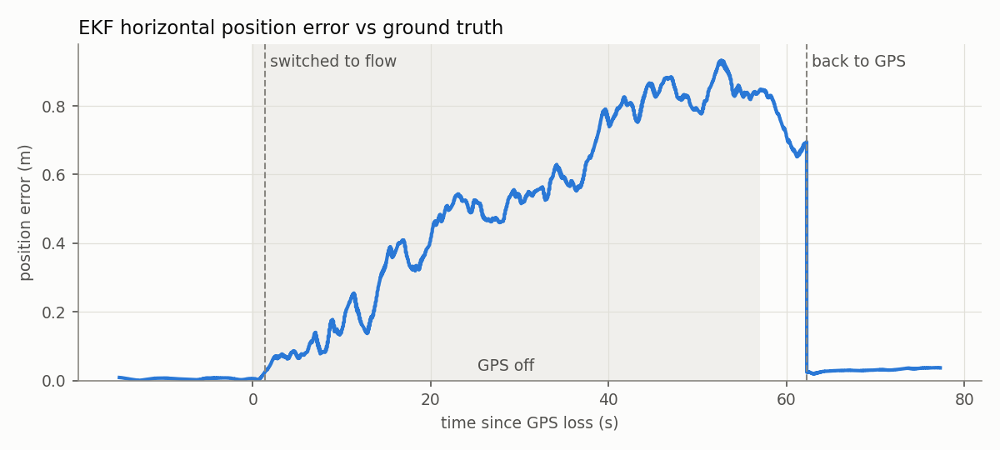
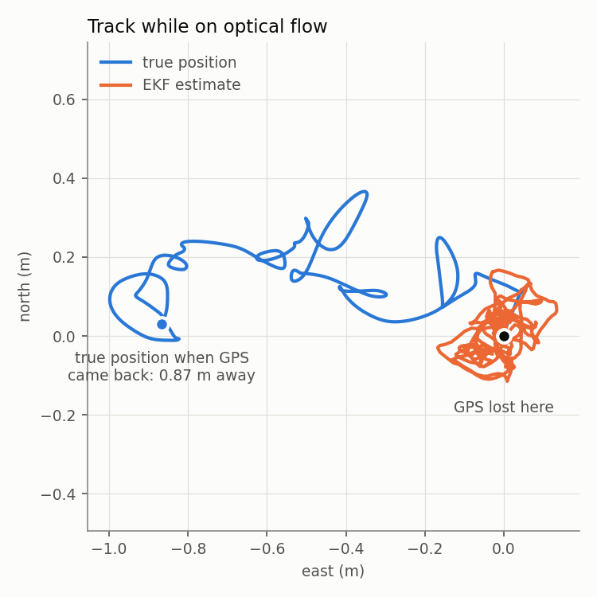

# GPS loss → optical flow fallback

[](https://youtu.be/muZEITKe7_o)

The question here is simple: if GPS dies mid-flight, can the quad keep flying
on optical flow and a downward rangefinder, and how much does its position
estimate drift while it does?

Everything runs in ArduPilot SITL (Copter 4.7-dev) with Gazebo Harmonic, in a
warehouse world.

## Setup

**Rangefinder.** I made a copy of the stock `iris_with_ardupilot` model,
`iris_with_rangefinder`, with a single-beam `gpu_lidar` pointing straight
down, 10 cm below the body. The ArduPilot Gazebo plugin already forwards range
sensors to SITL, so it only needed a `<sensor>` entry in the plugin block. On
the ArduPilot side it's `RNGFND1_TYPE 100`, facing down, 0.15–40 m.

**Optical flow.** This one is ArduPilot's own simulated flow sensor
(`SIM_FLOW_ENABLE 1`, `FLOW_TYPE 10`), computed from the vehicle state Gazebo
sends back. It assumes flat ground, which is fine on the warehouse floor.

**Two EKF3 source sets** ([`p1_sources.parm`](../ga_sim/params/p1_sources.parm)):

| | Set 1 (normal) | Set 2 (GPS-denied) |
|---|---|---|
| Horizontal position | GPS | none |
| Horizontal velocity | GPS | optical flow |
| Height | baro | baro |
| Vertical velocity | GPS | none |
| Yaw | compass | compass |

Height stays on the baro in both sets. The rangefinder sees whatever is under
it, and in a warehouse that includes racks.

## How the rangefinder fits in

The rangefinder doesn't fly the drone by itself. Its job is to make the flow
sensor useful.

A flow sensor only sees how fast the floor texture slides across its view,
as an angular rate. Two things move that image: the drone actually moving, and
the drone tilting. So the EKF first subtracts the gyro rates, and what's left
is translation. That number still isn't a speed, because the same ground speed
looks fast from 1 m up and slow from 10 m up. Multiply by the distance to the
floor and you get metres per second:

```
ground speed ≈ (flow rate − body rate) × height above ground
```

The height above ground comes from the rangefinder. With that, EKF3 has a
horizontal velocity it can trust, and ArduPilot's normal position controller
in GUIDED keeps doing its job, just on a different input. Nothing in the
controller changes.

What flow can't give you is position. The EKF builds position up from velocity
over time, so any small velocity error turns into slow drift that the EKF
itself can't see. That's exactly what showed up in the results.

## Switching logic

EKF3 does not change source sets on its own, so something has to tell it.
I did that from ROS 2 with a small node,
[`source_switcher.py`](../ga_ws/src/ga_vehicle/ga_vehicle/source_switcher.py),
on top of the existing MAVROS adapter:

- GPS counts as bad if the fix drops below 3D, it sees fewer than 6
  satellites, or GPS status stops arriving for 1 s.
- Bad for 1 s → send `MAV_CMD_SET_EKF_SOURCE_SET` with set 2.
- Good again for 5 s → back to set 1. The longer wait is so a marginal fix
  doesn't make it flip back and forth.

The command goes through `/mavros/cmd/command`. ArduPilot logs every source
change as an event, which is how the timings below were measured.

## Running the test

```bash
bash scripts/start_rangfinder.sh        # Gazebo, SITL + MAVProxy, MAVROS

source ga_ws/install/setup.bash
ros2 run ga_vehicle source_switcher
```

Then from the MAVProxy console:

```
mode guided
arm throttle
takeoff 5
param set SIM_GPS1_ENABLE 0     # kill GPS, hover for about a minute
param set SIM_GPS1_ENABLE 1     # bring it back
mode land
```

The plots come straight from the dataflash log:

```bash
python3 tools/eval/p1_gps_loss_plots.py runs/sitl/logs/00000004.BIN --out docs/img
```

It compares the EKF position (`XKF1`) against SITL's ground truth (`SIM2`) and
finds the fault and switch times on its own.

## Results

| | |
|---|---|
| GPS lost → switched to flow | 1.3 s |
| Time flying on flow | 55.6 s |
| Position error on flow | 0.52 m mean, 0.93 m max |
| Actual drift during the outage | 0.87 m |
| Drift the EKF thought it had | 0.03 m |
| GPS back → switched to GPS | 5.4 s |
| Error after switching back | ~3 cm |



The error grows at roughly 1.6 cm/s for the whole outage. When set 1 comes
back, the EKF snaps about 0.7 m onto the GPS position and the error drops to a
few centimetres straight away.



This one shows the drift problem well. The EKF (orange) thinks the drone is
holding still around the point where GPS was lost. In reality (blue) it
wandered off almost a metre to the west. Velocity was good enough to hover,
but nothing was correcting position.

No failsafe triggered at any point and the drone stayed in GUIDED the whole
time. The rangefinder read 5.08–5.10 m throughout the hover.

## Limitations

- One run, in simulation. The flow model is clean and the floor is flat;
  real flow sensors are noisier and depend on texture and light.
- The switch is done off-board over MAVROS, so it depends on the link. If the
  link dropped at the same time as GPS, nothing would switch.

The follow-up, [the EKF3 fault matrix](fault_matrix.md), moves the switch
onboard with ArduPilot's Lua script (and fixes a gap that stops the stock
script seeing a total GPS loss), and adds GPS glitches, IMU biases and
compass faults over repeated runs.
